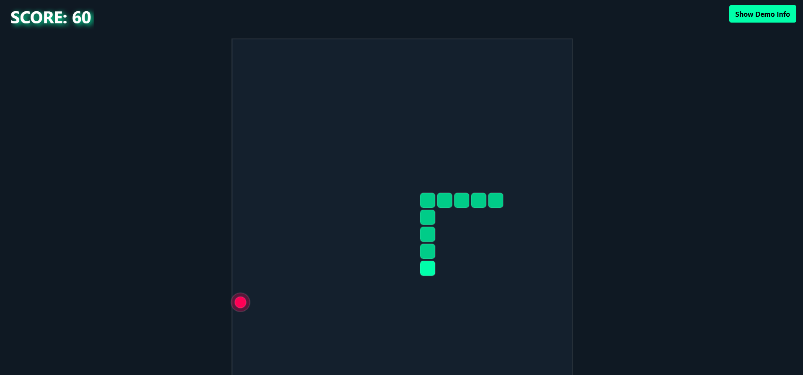

# Neon Snake & Network Recovery Demo



A high-performance, mobile-optimized interactive client built to demonstrate iGaming-specific frontend architecture: PixiJS rendering at 60 FPS, strict network state recovery, and bundle size optimization (<250KB).

## Core Architecture & Technical Highlights
1. **Ultra-Lightweight Bundle (~95KB Gzip):** Uses Vanilla TypeScript and modular, bare-module PixiJS imports tree-shaken with Terser to bypass heavy framework overhead (React/Next.js/Vue).
2. **60 FPS Canvas Rendering:** Built on PixiJS's delta-time Ticker with responsive auto-resizing across desktop and mobile viewports.
3. **Deterministic Network Recovery:** Implements WebSocket disconnection handling with exponential backoff and absolute state reconciliation.
4. **Automated Testing:** Vitest unit test suite covering unannounced socket drops and state recovery.

## Tech Stack
- **Engine:** PixiJS (modular packages)
- **Tooling:** Vite, Terser
- **Language:** TypeScript
- **Testing:** Vitest

## Getting Started

### Installation
```bash
npm install
```

### Running Locally
```bash
npm run dev
```

### Running Tests
```bash
npm run test
```

### Production Build
```bash
npm run build
```